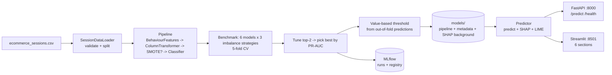
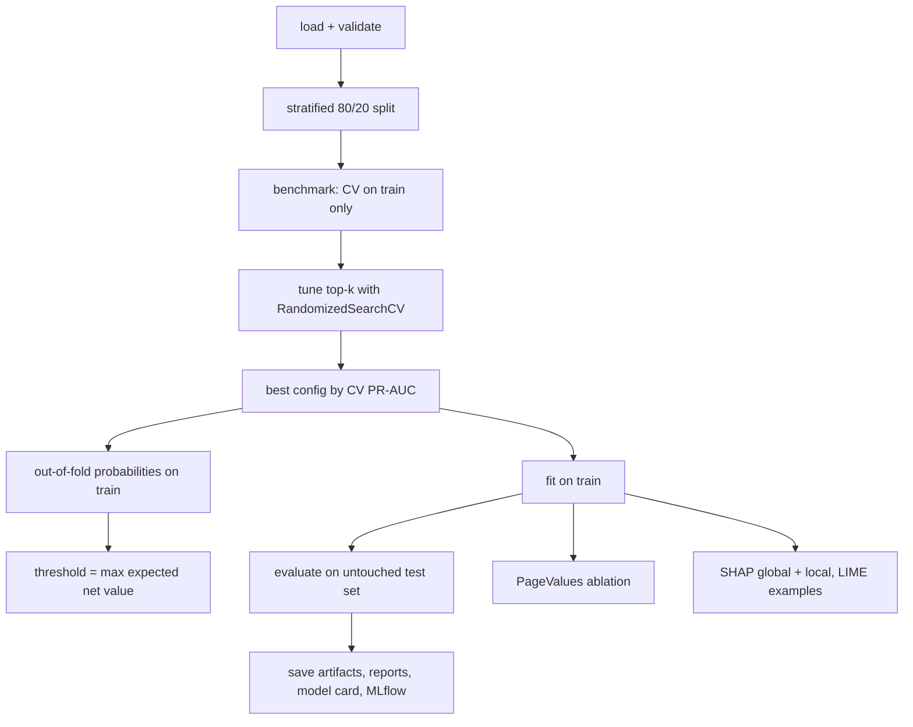
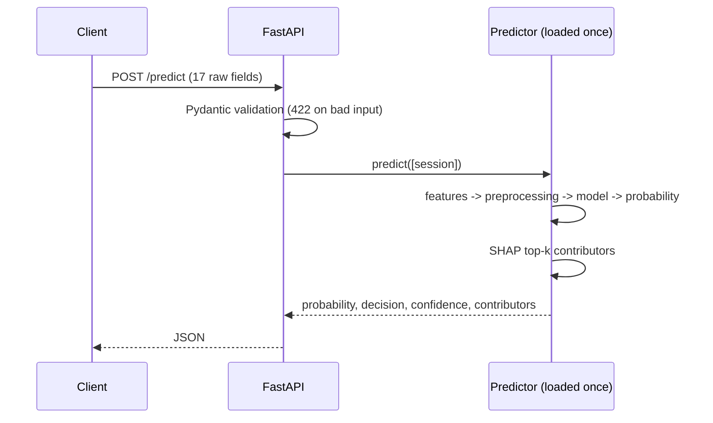

# Architecture

## System overview

## Training pipeline (what happens in `python -m src.models.train`)

## Serving

## Folder map
| Path | Responsibility |
|---|---|
| `src/config/` | `config.yaml` (all parameters, column lists) + typed `Settings` loader |
| `src/data/loader.py` | Read, validate, split data (single entry point for all code) |
| `src/features/engineering.py` | `BehaviourFeatures` transformer (6 engineered features, PageValues switch) |
| `src/preprocessing/pipeline.py` | ColumnTransformer + SMOTE inside the imblearn Pipeline |
| `src/models/trainers.py` | Six algorithms behind one `BaseTrainer` interface |
| `src/models/evaluation.py` | Metrics, business case, threshold selection |
| `src/models/train.py` | Orchestration: benchmark, tune, threshold, ablation, explain, save |
| `src/models/predictor.py` | Serving logic shared by API and dashboard |
| `src/models/tracking.py` | MLflow wrapper (tracking never breaks training) |
| `src/explain/` | `SessionExplainer` (SHAP + LIME), model-card generator |
| `src/api/` | FastAPI app + Pydantic schemas |
| `dashboard/app.py` | Streamlit app (6 sections) |
| `tests/` | pytest suite (config, data, features, models, explainers, API, dashboard) |
| `docker/`, `docker-compose.yml` | Container images and one-command run |
| `.github/workflows/ci.yml` | Lint + format + tests + Docker build |

## Key design decisions
1. **Everything that learns from data lives inside the Pipeline.** Encoding, scaling and SMOTE are fitted on the
   training folds only during cross-validation, so there is no leakage from validation folds.
2. **Integer-coded IDs are categories.** `OperatingSystems`, `Browser`, `Region`, `TrafficType` are one-hot encoded, never scaled.
3. **Same code for training and serving.** Feature engineering is a pipeline step, so the API cannot drift from training.
4. **Test set is touched once.** Model choice and threshold use cross-validation / out-of-fold predictions on train only.
5. **PR-AUC leads the metrics** (15.7% positives); accuracy is shown only next to the "nobody buys" baseline.
6. **Threshold from business value**, not 0.5 (see `business:` in `config.yaml`).
7. **Config over constants.** Change a column list, seed or business assumption in one YAML file.
